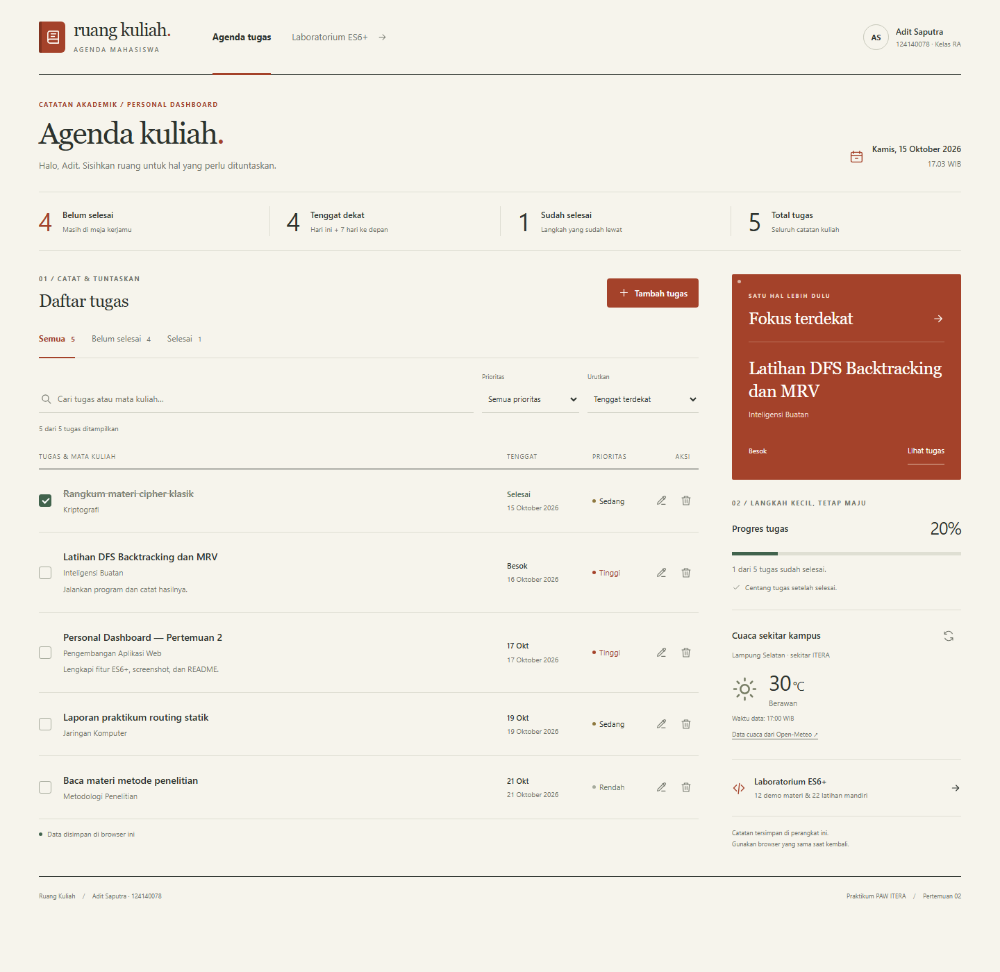
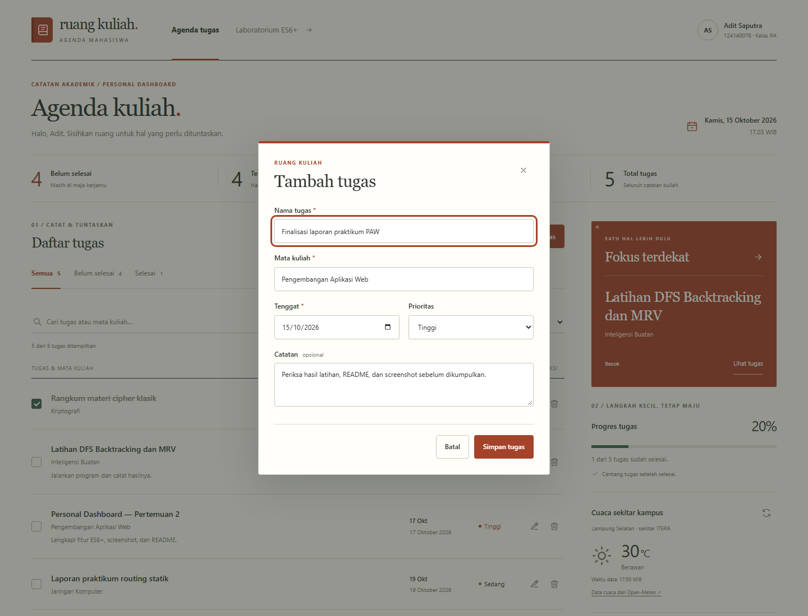
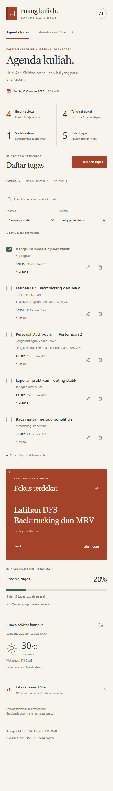
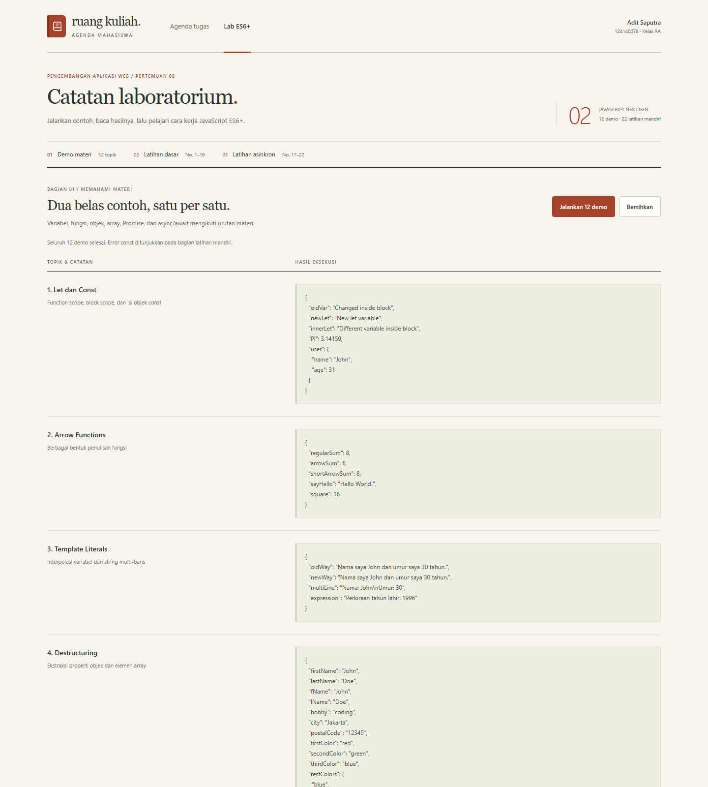
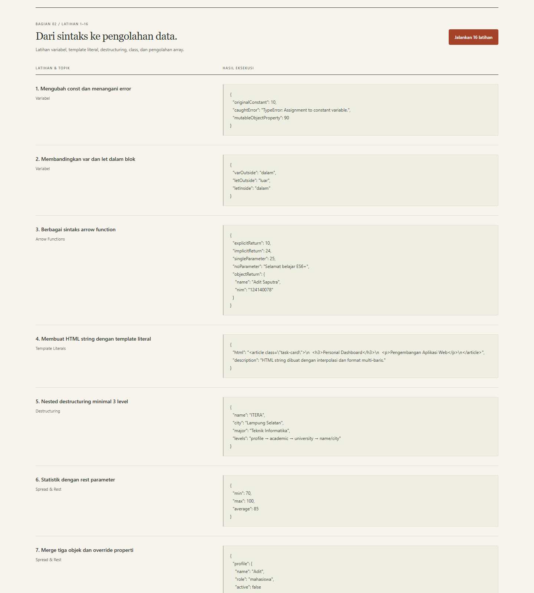
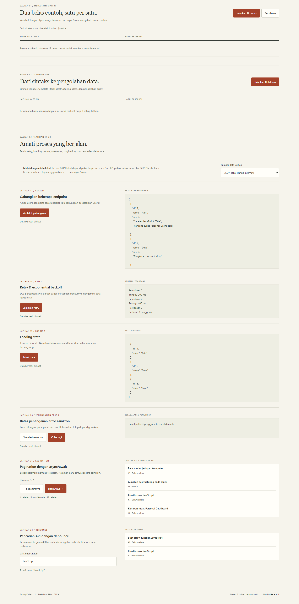

# Ruang Kuliah — Personal Dashboard

## Identitas

| Keterangan | Isi |
| --- | --- |
| Nama Lengkap | Adit Saputra |
| NIM | 124140078 |
| Kelas Praktikum | RA |
| Program Studi | Teknik Informatika, Institut Teknologi Sumatera |
| Pertemuan | 2 — JavaScript Next Gen (ES6+) |

## Deskripsi Aplikasi

Ruang Kuliah merupakan personal dashboard untuk mengelola tugas kuliah. Pengguna dapat mencatat nama tugas, mata kuliah, tenggat, prioritas, dan catatan, kemudian mengedit, menghapus, atau menandainya selesai. Data disimpan menggunakan localStorage agar tetap tersedia saat halaman di-refresh.

Tampilan disusun berdasarkan kebutuhan mahasiswa: **ringkasan tugas → daftar tugas → fokus terdekat, progres, dan cuaca kampus**. Desain memakai konsep agenda akademik dengan latar kertas hangat, garis pembatas, judul Georgia, isi Segoe UI, dan aksen merah bata. Pada ponsel, kolom tugas disusun ulang agar informasi dan tombol tetap mudah digunakan.

Aplikasi dibuat menggunakan HTML, CSS, dan JavaScript tanpa framework. Halaman **Laboratorium ES6+** berisi 12 demo materi dan 22 latihan mandiri Pertemuan 2.

## Struktur Proyek

Nama repository: **`pemrograman_web_itera_124140078`**.

Nama folder pertemuan: **`aditsaputra_124140078_pertemuan2`**.

| File atau folder di dalam folder pertemuan | Fungsi |
| --- | --- |
| `index.html` | Struktur aplikasi Personal Dashboard. |
| `css/style.css` | Tampilan dashboard dan tata letak responsif. |
| `js/main.js` | Pengendali event formulir, tombol, filter, pencarian, dan jam. |
| `js/app.js` | Class TaskItem dan DashboardApp untuk CRUD, localStorage, rendering, dan cuaca. |
| `js/modules/utils.js` | Helper tanggal, statistik, escape HTML, debounce, dan fetch JSON. |
| `js/modules/data.js` | Konfigurasi penyimpanan, prioritas, endpoint cuaca, dan data contoh. |
| `README.md` | Seluruh dokumentasi tugas, praktikum, latihan, dan hasil pengujian. |
| `modul/index.html` | Halaman demo dan latihan JavaScript ES6+. |
| `modul/css/style.css` | Tampilan halaman laboratorium. |
| `modul/js/main.js` | Pengendali tombol dan output demo serta latihan dasar. |
| `modul/js/app.js` | Dua belas contoh fitur ES6+. |
| `modul/js/latihan.js` | Enam belas latihan dasar ES6+. |
| `modul/js/latihan-async.js` | Enam latihan asinkron. |
| `modul/js/modules/` | Data dan fungsi pendukung demo serta latihan. |
| `modul/data/` | Berkas JSON lokal users, posts, dan todos untuk latihan fetch. |
| `screenshots/` | Enam gambar dokumentasi dashboard dan praktikum. |

## Panduan Menjalankan

1. Buka folder `pemrograman_web_itera_124140078` di VS Code.
2. Pasang ekstensi **Live Server** dari **Ritwick Dey** apabila belum tersedia.
3. Klik kanan pada `aditsaputra_124140078_pertemuan2/index.html`, lalu pilih **Open with Live Server**.
4. Klik **Tambah tugas**, isi nama tugas, mata kuliah, tenggat, prioritas, dan catatan, lalu klik **Simpan tugas**. Tombol **Gunakan data contoh** tersedia ketika daftar masih kosong.
5. Gunakan ikon pensil untuk mengedit, ikon tempat sampah untuk membuka konfirmasi hapus, dan checkbox untuk mengubah status selesai.
6. Gunakan tab status, pencarian, filter prioritas, dan pilihan urutan untuk menemukan tugas.
7. Klik **Laboratorium ES6+**, lalu jalankan **12 demo**, **16 latihan dasar**, dan masing-masing panel **latihan asinkron**. Hasil eksekusi ditampilkan langsung pada halaman.
8. Untuk latihan asinkron, gunakan **JSON lokal** atau pilih **API publik · JSONPlaceholder**. Gunakan **Simulasikan error**, lalu **Coba lagi** untuk mempelajari penanganan kegagalan.

**Gunakan Live Server sesuai arahan Pertemuan 2.** Membuka HTML langsung melalui `file://` dapat memblokir import/export dan fetch JSON lokal. Tidak diperlukan npm install atau proses build. Dashboard dapat mengelola tugas tanpa API; widget cuaca dan mode API publik memerlukan internet.

## Daftar Fitur

- [x] Tambah tugas dengan nama, mata kuliah, tenggat, prioritas, dan catatan.
- [x] Validasi nama tugas wajib diisi maksimal 120 karakter, mata kuliah maksimal 80 karakter, tanggal valid, serta catatan maksimal 600 karakter.
- [x] Edit tugas dengan mempertahankan id dan waktu pencatatan awal.
- [x] Hapus tugas melalui dialog konfirmasi.
- [x] Tandai tugas selesai atau kembalikan menjadi belum selesai.
- [x] Pencarian berdasarkan nama tugas atau mata kuliah.
- [x] Filter status dan prioritas, serta urutan tenggat, prioritas, atau terbaru.
- [x] Ringkasan total, belum selesai, selesai, dan tenggat dekat.
- [x] Fokus pada tugas belum selesai dengan tenggat paling awal dan persentase progres.
- [x] Simpan dan muat data tugas menggunakan localStorage.
- [x] Penanganan data rusak, penyimpanan tidak tersedia, dan penyimpanan penuh.
- [x] Tanggal dan jam WIB serta cuaca sekitar ITERA melalui fetch dan async/await.
- [x] Implementasi let, const, minimal tiga arrow function, template literals, dan classes.
- [x] Dua belas demo materi, enam belas latihan dasar, dan enam latihan asinkron.
- [x] Keadaan kosong, memuat, berhasil, gagal, hover, dan focus sesuai fungsi komponen.
- [x] File HTML, CSS, dan JavaScript dipisahkan; tampilan menyesuaikan desktop dan ponsel.

## Isi Folder Praktikum `modul/`

### Demo Materi

| Materi | Contoh yang dijalankan |
| --- | --- |
| Let dan Const | Function scope, block scope, serta perubahan properti objek const. |
| Arrow Functions | Bentuk tanpa parameter, satu parameter, implicit return, dan return objek. |
| Template Literals | Interpolasi variabel dan string multi-baris. |
| Destructuring | Pengambilan properti objek, nested object, dan elemen array. |
| Spread dan Rest | Penyalinan array/objek dan fungsi dengan argumen fleksibel. |
| Default Parameters | Parameter bawaan dan penggunaan nilai falsy. |
| Classes | Constructor, method, inheritance, dan instanceof. |
| Enhanced Object Literals | Property shorthand, method shorthand, dan computed property names. |
| Modern Array Methods | map, filter, find, some, every, reduce, dan chaining. |
| Advanced Arrays | Array.from, Array.of, flat, flatMap, dan includes. |
| Promises | then, catch, chaining, Promise.all, dan Promise.race. |
| Async/Await | Pemanggilan berurutan, paralel, dan penanganan error melalui try/catch. |

### Latihan Mandiri

| No. | Latihan dan hasil utama | File dan baris |
| --- | --- | --- |
| 1 | Penugasan ulang const menghasilkan TypeError yang ditangani; properti objek const tetap dapat diubah. | `modul/js/latihan.js:5` |
| 2 | var di dalam blok mengubah nilai luar; let di dalam blok tidak menimpa let luar. | `modul/js/latihan.js:14` |
| 3 | Berbagai sintaks arrow function menghasilkan angka, sapaan, dan objek mahasiswa. | `modul/js/latihan.js:22` |
| 4 | HTML string Personal Dashboard dibentuk menggunakan template literal. | `modul/js/latihan.js:31` |
| 5 | Nested destructuring mengambil data melalui profile → academic → university. | `modul/js/latihan.js:39` |
| 6 | Rest parameter menghitung min 70, max 100, dan average 85 dari angka 70, 80, 90, 100. | `modul/js/latihan.js:45` |
| 7 | Tiga objek digabung menggunakan spread; properti yang sama ditimpa oleh objek terakhir. | `modul/js/latihan.js:51` |
| 8 | Nama dan kategori produk dibaca menggunakan destructuring dalam for...of. | `modul/js/latihan.js:58` |
| 9 | DigitalProduct dan PhysicalProduct mewarisi class Product. | `modul/js/latihan.js:65`, `:75`, `:80` |
| 10 | Getter/setter mengubah harga dari 40.000 ke 35.000 dan menolak harga negatif. | `modul/js/latihan.js:92` |
| 11 | Computed property names menghasilkan properti mahasiswa_nama, mahasiswa_nim, dan semester_5. | `modul/js/latihan.js:101` |
| 12 | Default parameter digabung dengan destructuring; nilai active false tetap dipertahankan. | `modul/js/latihan.js:107` |
| 13 | groupBy memakai reduce untuk mengelompokkan produk berdasarkan kategori. | `modul/js/latihan.js:110` |
| 14 | Rata-rata harga dari array of objects dihitung sekitar Rp6.016.666,67. | `modul/js/latihan.js:114` |
| 15 | Array bersarang diratakan menggunakan flat dan flatMap. | `modul/js/latihan.js:116` |
| 16 | Filter, map, dan reduce digabung untuk analisis produk; total harga Rp32.550.000. | `modul/js/latihan.js:122` |
| 17 | Users dan posts di-fetch paralel dengan Promise.all lalu digabung berdasarkan userId. | `modul/js/latihan-async.js:40` |
| 18 | Retry memakai exponential backoff 200 ms dan 400 ms; percobaan ketiga mengambil data. | `modul/js/latihan-async.js:48` |
| 19 | Loading ditampilkan dan tombol dinonaktifkan selama operasi, lalu dipulihkan melalui finally. | `modul/js/latihan-async.js:62` |
| 20 | Error ditangani pada panel terkait; Coba lagi memulihkan data. Kedua tombol dikunci bersama selama proses. | `modul/js/latihan-async.js:62`, `:137` |
| 21 | Dua belas catatan lokal dibagi menjadi tiga halaman dengan empat catatan per halaman. | `modul/js/latihan-async.js:184` |
| 22 | Debounced search melakukan fetch setelah jeda 400 ms; respons lama tidak menimpa hasil terbaru. | `modul/js/latihan-async.js:156`, `:219` |

Folder ini mengikuti materi dan latihan Pertemuan 2. JSON lokal digunakan sebagai sumber bawaan agar latihan fetch tetap dapat dijalankan tanpa internet. Pilihan API publik mengganti sumber ke JSONPlaceholder. Penanganan error menggunakan JavaScript biasa dengan try/catch/finally.

## Tangkapan Layar

Dokumentasi terdiri dari enam screenshot yang tersimpan di folder `screenshots/`. Gambar diambil pada **15 Oktober 2026** dari aplikasi yang berjalan melalui Live Server menggunakan Chrome headless. Dashboard memakai data contoh bawaan, cuaca berasal dari respons Open-Meteo saat pengambilan, dan latihan asinkron memakai JSON lokal.

### 1. Dashboard Desktop

Dashboard menampilkan **5 tugas**, terdiri dari **4 belum selesai** dan **1 selesai**, dengan progres **20%**. Daftar memuat nama tugas, mata kuliah, tenggat, prioritas, dan aksi. Panel fokus menampilkan tugas belum selesai dengan tenggat terdekat.

### 2. Form Tambah Tugas

Form berisi tugas **Finalisasi laporan praktikum PAW**, mata kuliah **Pengembangan Aplikasi Web**, tenggat, prioritas **Tinggi**, dan catatan pemeriksaan laporan. Tombol **Batal** dan **Simpan tugas** tersedia di bawah formulir.

### 3. Tampilan Ponsel

Screenshot menggunakan lebar konten **390 px**. Informasi tugas disusun bertingkat, tombol edit/hapus tetap tersedia, dan panel fokus, progres, serta cuaca ditempatkan setelah daftar tugas.

### 4. Demo Materi ES6+

Seluruh **12 demo** sudah dijalankan. Screenshot menampilkan bagian awal hasil eksekusi, antara lain let/const, arrow functions, template literals, dan destructuring. Hasil lainnya dapat dibaca dengan menggulir halaman.

### 5. Latihan Dasar

Seluruh **16 latihan dasar** sudah dijalankan. Bagian awal output memperlihatkan error penugasan ulang const yang ditangani, perbedaan scope var/let, sintaks arrow function, template literal, nested destructuring, dan statistik menggunakan rest parameter.

### 6. Latihan Asinkron

Screenshot memperlihatkan hasil latihan **17–22**: penggabungan endpoint, retry, loading, pemulihan error, pagination **halaman 2 dari 3**, dan pencarian **JavaScript** yang menghasilkan dua catatan. Latihan 20 telah dipulihkan menggunakan tombol **Coba lagi**.

## Penjelasan Teknis Singkat

### Pengelolaan Tugas

Event submit ditangani menggunakan `event.preventDefault()` agar halaman tidak di-refresh. `TaskItem.validate()` memeriksa nama tugas, mata kuliah, tanggal, prioritas, dan catatan. `DashboardApp` mengelola penambahan, pengeditan, penghapusan, perubahan status, serta rendering daftar dan ringkasan.

Penambahan memakai spread untuk membentuk array baru, pengeditan menggunakan map, dan penghapusan menggunakan filter. Teks pengguna di-escape sebelum dimasukkan ke template HTML. Tugas yang selesai tetap disimpan dan dapat dikembalikan menjadi belum selesai.

### Ringkasan dan Tenggat

| Informasi | Cara menghitung |
| --- | --- |
| Total tugas | Jumlah seluruh tugas yang dicatat. |
| Belum selesai | Jumlah tugas dengan completed bernilai false. |
| Sudah selesai | Jumlah tugas dengan completed bernilai true. |
| Tenggat dekat | Tugas belum selesai dengan tenggat dari hari ini sampai tujuh hari ke depan. |
| Progres | Jumlah tugas selesai ÷ total tugas × 100%, dibulatkan; 0% ketika daftar kosong. |
| Fokus terdekat | Tugas belum selesai dengan tanggal tenggat paling awal, lalu prioritas sebagai pembanding. |

Tanggal dan jam menggunakan zona waktu **Asia/Jakarta**. Tugas yang tanggalnya sudah lewat dan belum selesai diberi label **Lewat tenggat**.

### Serialisasi localStorage

`commitTasks()` menyimpan objek berisi version dan array tasks menggunakan `JSON.stringify()` dengan key `ruang-kuliah-tasks-v1`. Saat halaman dibuka, `loadTasks()` membaca data menggunakan `JSON.parse()`, memeriksa formatnya, lalu membentuk kembali setiap tugas menjadi instance TaskItem.

Data disimpan sebelum state aplikasi diganti. Jika penyimpanan penuh, perubahan tidak dianggap berhasil. Data rusak dicadangkan untuk pemulihan. Jika localStorage tidak tersedia, aplikasi memberi peringatan bahwa data hanya bertahan selama halaman terbuka. Penyimpanan berlaku pada browser dan alamat aplikasi yang sama.

### Implementasi Fitur ES6+

Nomor baris mengacu pada file di dalam folder Pertemuan 2.

| Fitur | File dan baris | Penggunaan |
| --- | --- | --- |
| const | `js/main.js:5` | Referensi instance dashboard yang tidak ditugaskan ulang. |
| let | `js/modules/utils.js:47` | ID timer debounce yang berubah saat mengetik. |
| Arrow function 1 | `js/modules/utils.js:2` | Helper pencarian elemen DOM. |
| Arrow function 2 | `js/modules/utils.js:3` | Escape teks sebelum rendering HTML. |
| Arrow function 3 | `js/modules/utils.js:7` | Menghasilkan tanggal lokal WIB. |
| Template literals | `js/app.js:138` | Rendering HTML baris tugas secara dinamis. |
| Async/await | `js/app.js:254` | Mengambil cuaca Open-Meteo secara asinkron. |
| Fetch dan timeout | `js/modules/utils.js:65` | Meminta JSON dengan batas waktu. |
| Class TaskItem | `js/app.js:5` | Model data, validasi, dan getter tugas. |
| Class DashboardApp | `js/app.js:30` | Pengelolaan state, CRUD, localStorage, dan API. |
| Destructuring dan default parameters | `js/app.js:6` | Mengambil properti dan memberi nilai bawaan pada constructor. |
| Spread operator | `js/app.js:98` | Membentuk array baru ketika menambah tugas. |
| Getter | `js/app.js:25` | Membaca label prioritas tugas. |
| Map, filter, dan find | `js/app.js:107`, `:111`, `:103` | Memperbarui, menghapus, dan mencari tugas. |
| Reduce | `js/modules/utils.js:39` | Menghitung statistik tugas. |
| Rest parameter | `js/modules/utils.js:48` | Meneruskan argumen pada callback debounce. |
| ES Modules | `js/main.js:1` | Membagi kode menggunakan import/export. |
| Enhanced object literals | `js/app.js:153` | Property shorthand pada objek ringkasan. |

### Operasi Asinkron

`loadWeather()` menggunakan fetch dan async/await untuk mengambil data cuaca sekitar ITERA dari Open-Meteo. Selama permintaan, status memuat ditampilkan dan tombol muat ulang dinonaktifkan. Permintaan dibatasi delapan detik. Jika gagal, panel menampilkan pesan kesalahan dan tombol dapat digunakan kembali. Pengelolaan tugas tetap berjalan ketika data cuaca belum tersedia.

Latihan asinkron menerapkan Promise.all, retry dengan exponential backoff, loading state, try/catch/finally, pagination, dan pencarian debounce. Kedua tombol pada panel error dikunci bersama agar operasi simulasi dan pemulihan tidak saling menimpa hasil.

### Hasil Pengujian

**35 dari 35 pemeriksaan logika lulus** menggunakan Node.js v24.21.0, meliputi CRUD, localStorage, validasi, filter/pengurutan, tanggal, escaping, penanganan penyimpanan gagal, 12 demo, 16 latihan dasar, dan operasi asinkron. Sintaks seluruh **10 berkas JavaScript** juga lulus pemeriksaan.

**61 dari 61 pemeriksaan browser lulus dalam 12 skenario Chrome headless.** Alur tambah, edit, centang, filter status, pencarian, hasil kosong, konfirmasi hapus, serta reload data diuji pada desktop dan ponsel. Lebar konten 320, 390, 768, 1024, dan 1440 px diperiksa tanpa overflow horizontal. Seluruh demo dan latihan dijalankan; enam screenshot diperiksa secara visual.

Cuaca Open-Meteo berhasil dimuat langsung. Mode JSONPlaceholder publik belum diuji langsung; latihan asinkron diuji dengan JSON lokal melalui HTTP. Kondisi cuaca gagal/tidak valid dan kegagalan penyimpanan diperiksa menggunakan simulasi terkontrol. Pengujian ini tidak mencakup seluruh browser atau perangkat fisik.

## Pengumpulan

Unggah folder **`aditsaputra_124140078_pertemuan2`** beserta seluruh isinya langsung ke root repository **`pemrograman_web_itera_124140078`**. Sertakan folder `modul/`, folder `screenshots/` berisi enam gambar di atas, serta README ini sebagai dokumentasi tugas dan laporan praktikum. Pastikan identitas dan seluruh file lengkap sebelum mengirim URL repository melalui formulir kelas **RA**.

Deadline pada format pengumpulan Pertemuan 2: **Sabtu, 17 Oktober 2026 pukul 23.59 WIB**.

- [Submit Tugas RA](https://forms.gle/J1dJrxXPGy1dtSs58)
- [Materi Pertemuan 2](https://praktikum-paw20262027.vercel.app/pertemuan/2)
- [Ketentuan Tugas Personal Dashboard](https://praktikum-paw20262027.vercel.app/pertemuan/2/tugas-praktikum)
- [Format Pengumpulan Pertemuan 2](https://praktikum-paw20262027.vercel.app/pertemuan/2/format-pengumpulan)
