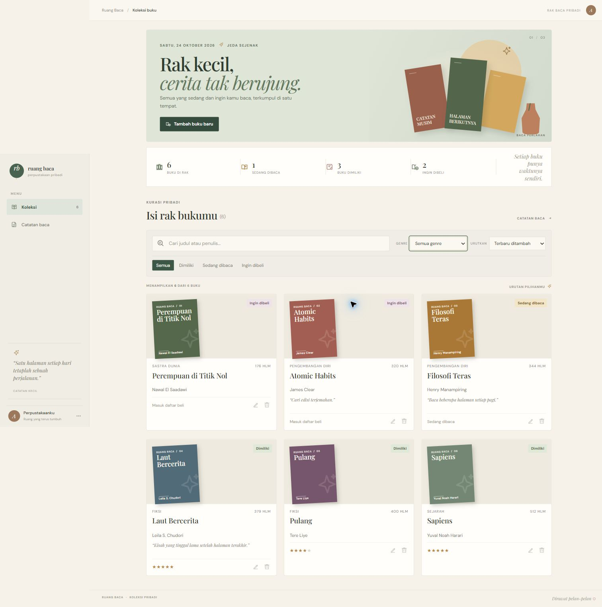
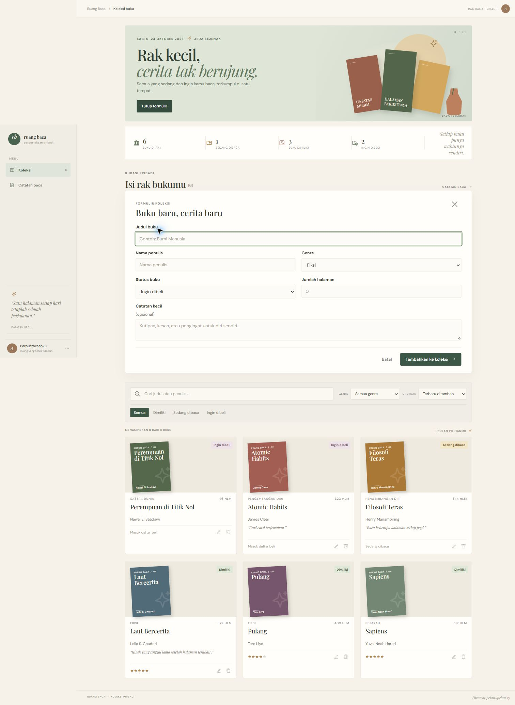
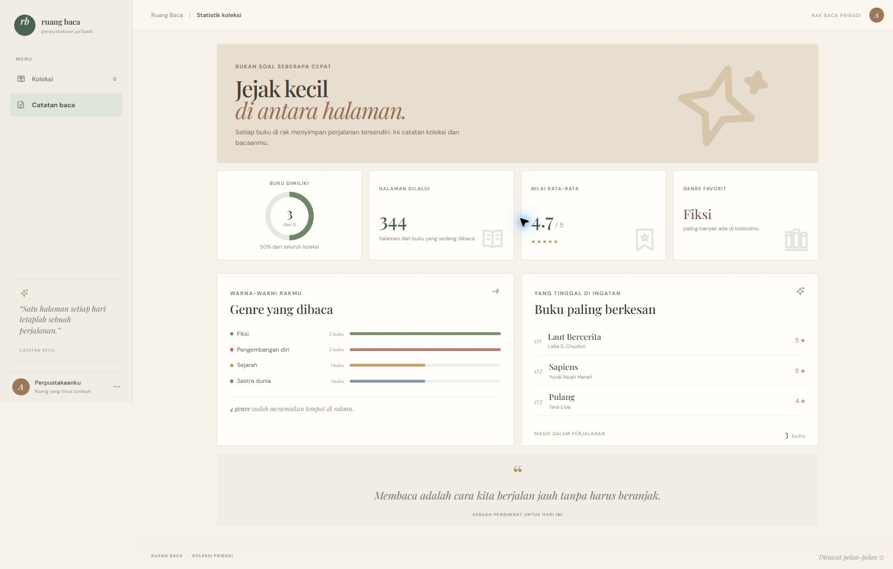
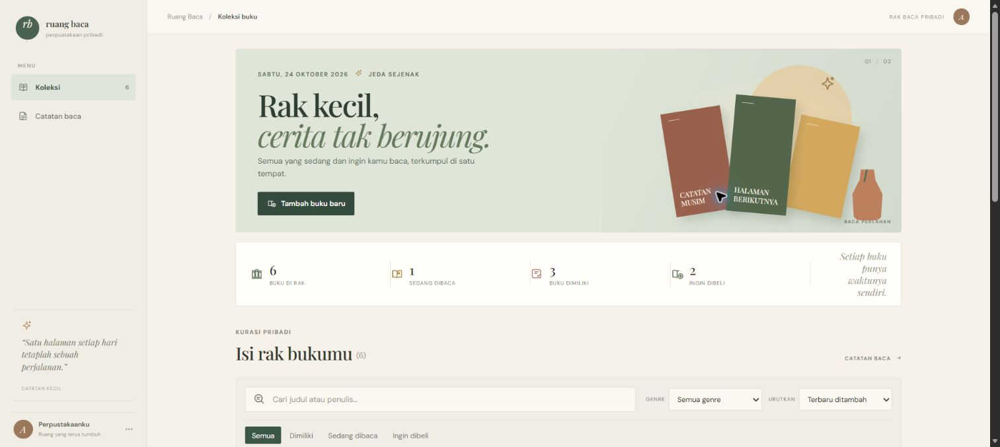
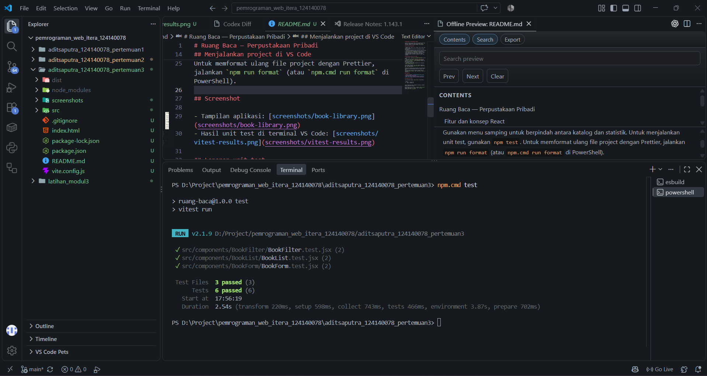

# Ruang Baca — Perpustakaan Pribadi

Aplikasi katalog buku pribadi untuk mencatat buku yang dimiliki, sedang dibaca, atau ingin dibeli. Data tersimpan otomatis di browser dengan `localStorage`.

## Fitur dan konsep React

- Tambah, edit, hapus, cari, urutkan, serta filter buku menurut status.
- `useState` mengelola nilai formulir dan pesan validasi; `useEffect` menyiapkan formulir saat buku dipilih dan menyinkronkan data ke `localStorage`.
- React Router menyediakan halaman koleksi dan statistik tanpa memuat ulang aplikasi.
- Context API membagikan koleksi dan aksi tambah, ubah, serta hapus buku ke halaman.
- Custom hook `useLocalStorage` menjaga data tetap ada setelah browser dimuat ulang; `useBookStats` menghitung ringkasan koleksi.
- Form memvalidasi judul dan penulis wajib isi, lalu menampilkan pesan dan penanda visual jika kosong.
- Komponen memakai functional components, Hooks, dan PropTypes untuk pemeriksaan tipe props.

## Menjalankan project di VS Code

1. Buka folder `aditsaputra_124140078_pertemuan3` di VS Code.
2. Buka terminal melalui **Terminal → New Terminal**.
3. Jalankan `npm install` untuk memasang dependency, termasuk `prop-types`, `react-router-dom`, Vitest, dan React Testing Library.
4. Jalankan `npm run dev`.
5. Buka alamat lokal yang ditampilkan Vite (biasanya `http://localhost:5173`).

Jika memakai PowerShell dan `npm` terkena pembatasan skrip, gunakan padanan `npm.cmd install`, `npm.cmd run dev`, dan `npm.cmd test`.

Gunakan menu samping untuk berpindah antara katalog dan statistik. Untuk menjalankan unit test, gunakan `npm test`.
Untuk memformat ulang file project dengan Prettier, jalankan `npm run format` (atau `npm.cmd run format` di PowerShell).

## Screenshot

Screenshot antarmuka lengkap:

#### Halaman koleksi

#### Formulir tambah buku

#### Halaman statistik

#### Tampilan koleksi ringkas

## Laporan unit test

Test dijalankan dengan `npm.cmd test` di PowerShell. Hasil yang tersimpan menunjukkan **3 file test dan 6 test berhasil**.

Komentar kode menjelaskan bagian penting pada validasi form, sinkronisasi `localStorage`, migrasi data Context, functional state updates, dan kalkulasi statistik.

Untuk membuat versi produksi, jalankan `npm run build`. Folder `node_modules/`, `dist/`, dan `coverage/` dikecualikan oleh `.gitignore`.
