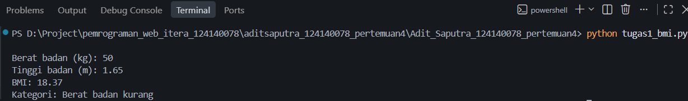
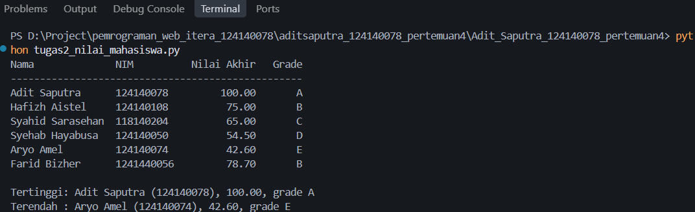
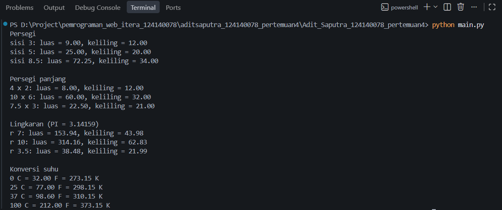

# Tugas Praktikum Pertemuan 4 - Dasar Pemrograman Python

- Nama : Adit Saputra
- NIM  : 124140078

## Deskripsi Program

**Soal 1 - `tugas1_bmi.py`**
Meminta input berat (kg) dan tinggi (m), menghitung BMI dengan fungsi
`hitung_bmi()`, lalu menentukan kategori dengan `tentukan_kategori()`
(if-elif-else). Hasil dicetak dengan 2 angka desimal.

**Soal 2 - `tugas2_nilai_mahasiswa.py`**
Data 6 mahasiswa disimpan dalam list of dictionary. Program menghitung nilai
akhir (30% UTS + 40% UAS + 30% tugas), menentukan grade A-E, mencetak tabel,
lalu mencari mahasiswa dengan nilai akhir tertinggi dan terendah.

**Soal 3 - `math_operations.py` dan `main.py`**
`math_operations.py` berisi konstanta `PI`, fungsi luas dan keliling (persegi,
persegi panjang, lingkaran), serta konversi Celsius ke Fahrenheit dan Kelvin.
`main.py` memanggil semua fungsi tersebut dengan beberapa nilai uji dan memakai
beberapa cara impor (`import`, `from ... import`, dan alias `as`).

**Latihan Mandiri (folder `docs/`)**
Berisi latihan mandiri dari modul: `latihan1.py` (identitas dan eksperimen
print), `latihan2_suhu.py` (konversi suhu), `latihan3_tebak.py` (tebak angka),
`latihan4_validasi.py` (validator password), `latihan5_kontak.py` (katalog
kontak), serta `password_gen.py` dan `main.py` (modul generator password).

## Cara Menjalankan

```
python tugas1_bmi.py
python tugas2_nilai_mahasiswa.py
python main.py
```

Latihan mandiri dijalankan dari dalam folder `docs/`, contohnya:

```
cd docs
python latihan1.py
python main.py
```

## Screenshot

Soal 1:



Soal 2:



Soal 3:


