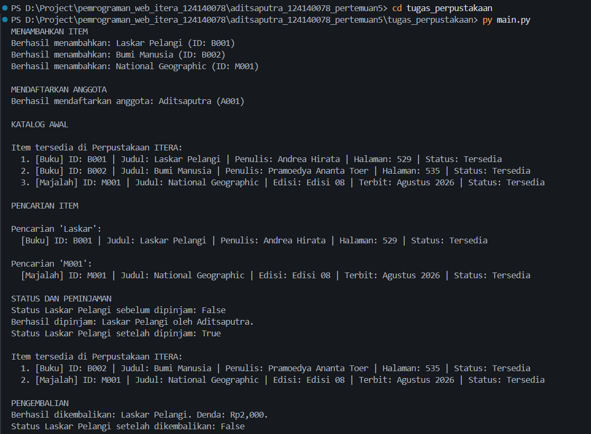
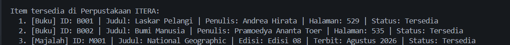

# Tugas: Sistem Manajemen Perpustakaan Sederhana

## Identitas Mahasiswa

- **Nama lengkap:** Adit Saputra
- **NIM:** 124140078
- **Kelas praktikum:** RA

## Deskripsi Program

Program ini mengelola buku dan majalah di Perpustakaan ITERA. Alur pada `main.py` dimulai dengan membuat perpustakaan, beberapa item, dan anggota. Program kemudian menambahkan item, menampilkan katalog, mencari item berdasarkan judul dan ID, memproses peminjaman, lalu mencatat pengembalian dan denda keterlambatan.

Penerapan konsep OOP:

- **Class:** `LibraryItem`, `Book`, `Magazine`, `Member`, dan `Library` menjadi cetak biru. `main.py` membuat objek buku, majalah, anggota, dan perpustakaan.
- **Inheritance:** `Book` dan `Magazine` mewarisi atribut serta perilaku umum dari abstract class `LibraryItem`.
- **Encapsulation:** `Library` menyimpan koleksi pada atribut private `__koleksi`; data anggota dan pinjaman juga dilindungi. Status item dibaca lewat property `is_dipinjam` dan diubah melalui method `pinjam()` atau `kembalikan()`.
- **Polymorphism:** katalog memanggil `get_detail()` untuk setiap item. `Book` dan `Magazine` menampilkan detail berbeda; keduanya juga memiliki perhitungan `hitung_denda()` masing-masing.
- **Abstract class dan property:** `LibraryItem` mewajibkan subclass mengimplementasikan `get_detail()` dan `hitung_denda()`. Property menyediakan akses terkontrol ke ID, judul, dan status item.

## Struktur Berkas

- `library_item.py`: abstract class `LibraryItem` dan subclass `Book` serta `Magazine`.
- `member.py`: class anggota dengan daftar pinjaman yang dienkapsulasi.
- `library.py`: pengelolaan koleksi privat, pencarian, katalog, peminjaman, dan pengembalian.
- `main.py`: contoh penggunaan seluruh fitur program.

## Panduan Menjalankan Program

Buka terminal pada folder `tugas_perpustakaan`, kemudian jalankan perintah berikut:

```bash
python main.py
```

## Screenshot Output

Gambar berikut merupakan keluaran saat `main.py` dijalankan. Gambar menampilkan penambahan item, pencarian berdasarkan judul dan ID, serta penampilan katalog.

 
 


